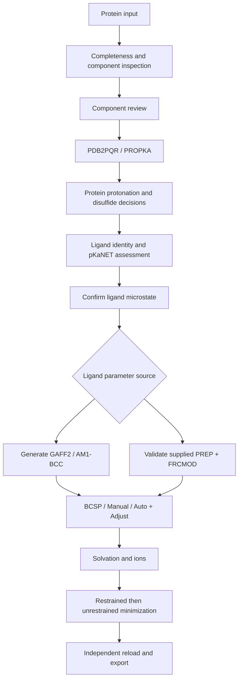

# DFDD — Protein–Ligand Input Generator

### ☁️ Colab-oriented · 🧬 Chemically aware preparation · 📦 AMBER-ready inputs

**Notebook:** [`Protein_Ligand_DFDD_Input_Generator.ipynb`](./Protein_Ligand_DFDD_Input_Generator.ipynb)  
**Development snapshot:** `v2.1-prep-frcmod-pbc-2026-10-28` · 28 October 2026  
**Status:** Development / local validation; hosted Google Colab execution remains unverified.

Prepare protein–ligand systems with structure inspection, protein protonation review, pKaNET Cloud+ ligand assessment, exterior ligand placement, explicit solvation, energy minimization, and validated AMBER export.

This generator is a **protein–ligand companion to DFDD**, the host–guest dynamic docking workflow described in *DFDD: A Cloud-Ready Tool for Distance-Guided Fully Dynamic Docking in Host–Guest Complexation*. The original paper's host–guest benchmarks do not establish validation of this protein–ligand extension.

> **Preparation versus simulation:** Steps 1–9 prepare, minimize, validate, and export the system. The current notebook also contains **Step 10**, which starts heating, equilibration, and production MD. Stop after Step 9 when preparing inputs only. Avoid **Run all** if you do not intend to execute Step 10.

---

## ✨ Features

- Protein input from an RCSB PDB ID or uploaded PDB/mmCIF.
- Sequence/completeness inspection, component inventory, and recorded preparation decisions.
- PDB2PQR/PROPKA recommendations with protein chemistry and disulfide review.
- Ligand input through SMILES, PubChem name/CID, or SDF/MOL/MOL2.
- Mandatory pKaNET Cloud+ assessment in the Step 5 ligand workflow, followed by explicit microstate confirmation.
- New organic ligand parameters using **GAFF2 / AM1-BCC**.
- Reuse of matching **AMBER PREP/PREPI/PREPIN + FRCMOD** bundles without refitting charges.
- **BCSP**, manual adjustment, and Auto + Adjust ligand placement.
- Selectable supported force fields, water models, bulk ions, and periodic box shapes.
- A py3Dmol periodic-box preview with an interactive **Show water** checkbox.
- Restrained and unrestrained minimization, convergence checks, and independent AMBER reload.
- Export packages, preparation reports, input hashes, and method citations.

## 🧭 Workflow

Unsupported chemistry, stale decisions, failed inspection, and failed convergence must be resolved before the affected preparation/export gates pass. A successful file conversion or OpenMM load alone is not scientific validation.

## 🚀 Quick start in Google Colab

1. Download the notebook from this repository.
2. Open [Google Colab](https://colab.research.google.com/) and choose **File → Upload notebook**.
3. Run **Setup A** and follow its runtime restart instructions.
4. Run **Setup B** to install dependencies and load the embedded supporting modules.
5. Run Steps **1–9 in order**, reading warnings and completing the review controls before continuing.
6. Download and retain the exported ZIP, reports, logs, and citation files.

For an explicitly reviewed preparation, choose **Review interactively** in Step 1. The alternative **Accept recommendations** mode records automatic recommendations; these records must not be described as human-confirmed decisions. Step 5 still requires its ligand microstate confirmation button.

An [existing shared Colab copy](https://colab.research.google.com/drive/1WWMoH8n43vn-MhQluJhtrr27gQQiak3f?usp=sharing) is available, but may predate the notebook in this repository. Upload the repository notebook to use this exact development snapshot.

### Main example: BRD4–JQ1 (`3MXF`)

The current notebook form defaults to PDB **3MXF**, chain **A**, a co-crystal site reference named **JQ1**, and an explicit isomeric JQ1 SMILES.

Treat these as **starting settings**, not a verified hosted benchmark. Inspect the downloaded structure, actual component IDs, chain selection, deposited sequence, ligand stereochemistry, and source records. Correct any mismatch before proceeding. No completed hosted 3MXF execution or exported results have yet been supplied for review.

## 📓 Notebook steps

| Cell | What it does |
|---|---|
| Setup A / B | Install the runtime and load embedded modules. |
| **1 — Settings** | Set protein input, chains, binding site, protein pH, review mode, and placement offset. |
| **2 — Load & inspect protein** | Inspect the original input and show its structure. |
| **3 — Confirm components** | Review protein chains, waters, ligands, cofactors, and ions. |
| **4 — Protein preparation** | Run PDB2PQR/PROPKA, review chemistry/disulfides, and prepare the protein. |
| **5 — Ligand Preparation** | Assess identity and microstates; generate parameters or validate an uploaded bundle. |
| **6 / optional 6b — Placement** | Apply BCSP or adjust actual ligand coordinates manually. |
| **7 — Solvation & force-field settings** | Build the solvated topology and display the periodic cell and optional water. |
| **8 — Minimize and validate** | Perform two-stage minimization, check convergence, reload, and visualize. |
| **9 — Export** | Configure and download selected engine and PaCS-Q packages with reports/citations. |
| **10 — Optional MD execution** | Starts heating, equilibration, and production; outside input-only preparation. |

## 🧪 Step 5: ligand preparation

### Generate new parameters

Choose **SMILES**, **PubChem name**, **PubChem CID**, or **Upload SDF/MOL2/MOL file**. Supply a chemically defined ligand, including stereochemistry where relevant.

The workflow checks identity, assesses protonation/tautomer candidates with pKaNET Cloud+, and asks you to click **Confirm microstate & prepare ligand**. It then generates 3D coordinates and uses AmberTools for **GAFF2 atom typing, AM1-BCC charges, and FRCMOD completion**.

- Ligand assessment pH defaults to **7.4** and is separate from confirmed protein pH.
- Advanced controls expose the pH window, maximum tautomers, and top-ranked microstates.
- Charge follows the confirmed molecular state; there is no arbitrary charge override.
- pKaNET rankings use heuristic methods; they are not experimental pKa measurements.
- AM1-BCC uses AmberTools' semiempirical calculation machinery. No separate external QM package is required by this route, but preparation time depends on ligand size and chemistry.

Uploading MOL2 in this mode does **not** preserve its original charges as a user-parameter bundle: new GAFF2/AM1-BCC parameters are generated.

### Reuse existing AMBER parameters

1. Set **Ligand force-field source → Existing AMBER PREP + FRCMOD**.
2. Enter the matching ligand SMILES, PubChem name, or CID for chemical assessment.
3. Select the bundle's original **GAFF** or **GAFF2** base.
4. Describe the parameter and charge provenance.
5. Upload exactly one `.prep`, `.prepi`, or `.prepin` file and one `.frcmod` file together. Leave both path fields blank to open the Colab upload dialog.
6. Review and confirm the ligand microstate.

The generator converts PREP coordinates into `ligand_from_prep.pdb` for viewing and produces a validated MOL2/FRCMOD pair for placement and assembly. **The PDB is not the force-field source.** Original types and charges are preserved, with isolated topology checks and a parameter/connectivity roundtrip audit.

This route supports **one isolated organic GAFF/GAFF2-compatible ligand residue**. It blocks mismatched chemistry, unsupported atom types, CHARMM/GLYCAM templates, metal centers, and covalently attached ligands. PREP alone does not reliably establish chemical bond orders or electronic state, so matching identity remains necessary. A different pKaNET state requires compatible parameters rather than automatic alteration of the uploaded bundle.

## 📍 BCSP and manual placement

**Bidirectional COM–Surface Placement (BCSP)** uses the selected binding-site center and protein center of mass to construct two rays. It finds exterior intersections of the solvent-inflated atomic envelope, compares valid outward directions, and checks clashes/accessibility.

The current default offset is **25 Å beyond the selected exterior surface to the ligand COM**. It is not a 25 Å distance from the binding-pocket center.

Use **optional Step 6b** for manual adjustment, then click **Confirm Placement**. Translation and rotation change ligand atomic coordinates, not just the camera. BCSP provides a starting geometry; it does not predict a validated binding tunnel, entry pathway, or induced fit.

## 💧 Step 7: force fields, solvent, and periodic box

| Setting | Current options |
|---|---|
| Protein | ff19SB or ff14SB |
| Newly parameterized ligand | GAFF2 / AM1-BCC |
| Supplied ligand bundle | Validated original GAFF or GAFF2; supplied charges retained |
| Enabled water models | OPC, TIP3P, TIP4P-Ew, SPC/E |
| Bulk ions | Neutralize only; neutralize + NaCl/KCl; no ions for a neutral solute |
| Box | Cubic (`iso` sizing), rectangular, truncated octahedron |

Original TIP4P, TIP5P, and SPC appear in the form but currently stop with an unsupported-bundle diagnostic. They are not aliases for TIP4P-Ew or SPC/E. RNA/lipid selections are also blocked in this protein preparation route until a compatible workflow is validated.

Keep **show_solvated_preview** enabled to display the actual exported AMBER lattice. Orange edges outline the periodic cell. The output **Show water** checkbox changes visibility without deleting solvent or rerunning tleap. For truncated octahedra, the preview shows the triclinic periodic cell rather than its Wigner–Seitz polyhedron.

## 🧬 Protein chemistry and specialized systems

Inspect all component decisions and structure-handling settings. Cofactors, bound ligands, waters, and ions require chemical interpretation; their presence in a crystal does not automatically establish biological relevance or parameter support.

The form includes terminal-trimming and uploaded-completeness settings. Review their consequences and retain their reports; neither setting proves experimental sequence completeness. Internal-gap repair, when permitted, produces approximate coordinates requiring inspection.

A specialized CYP450 pathway includes an explicitly documented **ferric pentacoordinate high-spin IC6** model. This is not general support for every heme oxidation/spin state. The state requires evidence and compatible coordination; the pathway retains its ff19SB/OPC restriction. Unsupported metal/cofactor chemistry must be resolved through an appropriate documented model rather than deleted or parameterized as an ordinary organic ligand.

## 📦 Outputs

Successful preparation can produce:

- `complex.prmtop` — AMBER topology.
- `complex.rst7` — solvated starting coordinates and periodic cell.
- `complex_min.rst7` / `complex_min.pdb` — minimized coordinates and structure.
- `ligand.mol2` / `ligand.frcmod` — ligand parameters used for assembly.
- `ligand_from_prep.pdb` / `.sdf` — converted supplied-template geometry, when that route is selected.
- Identity, protonation, component, disulfide, placement, parameter, minimization, and reload reports.
- `CITATIONS.md`, `CITATIONS.json`, force-field provenance, hashes, and execution logs.
- Downloadable packages for selected **OpenMM, AMBER, GROMACS, and LB-PaCS-MD/PaCS-Q** targets, subject to their export checks.

Generated MD protocols/packages do not establish that MD was executed or validated. The generator does not by itself establish binding affinity, free energy, an association mechanism, or a successful binding event. The original DFDD host–guest notebook's DBFE/MM-PBSA/MM-GBSA outputs are not claimed as outputs of this input generator.

For an exported PaCS-Q package, use its supplied instructions and run **`bash run.sh --check`** from that package directory for the non-production check. Do not assume the same flag applies to every engine package.

## ✅ Verification status

| Item | Evidence-backed status |
|---|---|
| Latest focused local regression checks | **PASS — 19 tests** |
| Supplied benzene PREPI/FRCMOD conversion and isolated AMBER reload | **PASS** |
| Supplied-ligand insertion, OPC solvation, neutralization, and independent reload | **PASS — isolated assembly smoke test** |
| Charge/type retention and finite energy/forces in that fixture | **PASS** |
| Water-toggle callback and cubic/triclinic edge calculations | **PASS locally; rendering mocked in the widget test** |
| Full new PREP-based notebook minimization | **NOT_TESTED** |
| Actual hosted Colab execution of this snapshot | **UNVERIFIED** |
| Hosted 3MXF–JQ1 end-to-end workflow | **UNVERIFIED** |

The assembly smoke test uses a previous synthetic protein fixture with review, placement, and component gates mocked to isolate assembly. It is not a new end-to-end scientific approval. Earlier verified minimization results remain separate; they do not validate this new upload route or the hosted 3MXF example.

See [`reports/UPDATE_REPORT.json`](./reports/UPDATE_REPORT.json), [`reports/REAL_PREP_SMOKE.json`](./reports/REAL_PREP_SMOKE.json), and [`reports/ASSEMBLY_SMOKE.json`](./reports/ASSEMBLY_SMOKE.json). This snapshot is **not a verified hosted release**.

## 🛠️ Troubleshooting

| Problem | Action |
|---|---|
| Download unavailable | Retain the network diagnostic or upload an authentic structure; do not bypass inspection. |
| Protein preparation blocked | Inspect missing regions, selected components, chemistry decisions, and the reported unsupported model. |
| PREP and ligand disagree | Check identity, stereochemistry, hydrogens, net charge, base force field, and template provenance. |
| Missing or invalid parameters | Read the tleap/parameter logs and obtain a complete compatible parameter set. |
| Placement clashes or insufficient clearance | Adjust placement or box padding and rerun affected stages. |
| Minimization fails convergence | Inspect geometry, constraints, parameters, and optimizer diagnostics. Do not loosen acceptance solely to obtain PASS. |
| Old behavior after uploading an update | Use a fresh runtime and rerun setup so embedded modules are reloaded. |

## 📚 Citation and attribution

For the original DFDD method, cite:

**Hengphasatporn, K.; Duan, L.; Harada, R.; Shigeta, Y.**  
*DFDD: A Cloud-Ready Tool for Distance-Guided Fully Dynamic Docking in Host–Guest Complexation.*  
**Journal of Chemical Information and Modeling**, 2026.  
[https://doi.org/10.1021/acs.jcim.5c02852](https://doi.org/10.1021/acs.jcim.5c02852)

Retain the exported citation inventory and cite the methods actually used, including the selected protein/water model, ligand parameters and charge method, AmberTools, OpenMM, and relevant preparation tools. For uploaded parameters, retain their original references and licenses. Do not label user-supplied charges as AM1-BCC without evidence.

Related resources:

- [Original DFDD repository](https://github.com/nyelidl/DFDD)
- [pKaNET Cloud+ source and explorer](https://nyelidl.github.io/pKaNET_Cloud/)
- [Anyone Can Dock paper](https://doi.org/10.1186/s13321-026-01306-2)
- [Docking workshop](https://nyelidl.github.io/Docking_workshop/)

## License

A repository-wide license for this generator snapshot has not been established in this README. Add the owner's chosen `LICENSE` before public distribution and preserve all bundled third-party notices, including the upstream pKaNET MIT notice. A citation or an “Academic” badge is not a substitute for license terms.
